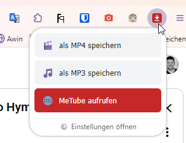
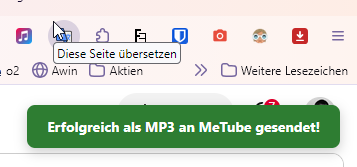

# Send to MeTube (Browser Extension)

Eine schlanke, plattformübergreifend einsetzbare Browser-Erweiterung (Manifest V3) für Firefox und Chromium-basierte Browser, um YouTube-Videos mit flexiblen Formatoptionen direkt an eine eigene [MeTube](https://github.com/alexta69/metube)-Instanz zu senden.

---

## 🎨 Funktionen

* **Schnell-Menü bei Linksklick:**
  * 🎬 **als MP4 speichern:** Überträgt das Video im MP4-Format an MeTube.
  * 🎵 **als MP3 speichern:** Extrahiert und speichert nur die Audiospur als MP3.
  * 📋 **Playlist an MeTube senden:** Extrahiert alle Videos einer geöffneten YouTube-Playlist und überträgt sie direkt an MeTube (wird automatisch auf Playlist-Seiten eingeblendet).
  * 🌐 **MeTube aufrufen:** Öffnet deine MeTube-Weboberfläche direkt in einem neuen Tab.
  * ⚙️ **Einstellungen:** Schneller Zugriff auf die Konfigurationsseite.



* **Kontextmenü bei Rechtsklick:** Ein Rechtsklick auf das Erweiterungssymbol bietet jederzeit die Option *„MeTube-Instanz öffnen“*.
* **In-Page Feedback (Toast-Benachrichtigung):** Nach der Übertragung poppt direkt oben rechts auf der YouTube-Seite eine visuelle Bestätigung auf.



* **Sichere Berechtigungsverwaltung:** Integrierter Berechtigungs-Checker auf der Einstellungsseite, um den Host-Zugriff auf deine MeTube-Domain mit einem Klick freizugeben.
* **Auto-Update Support:** Unterstützt automatische Updates über eine eigene `updates.json`.

---

## 🚀 Installation

Du kannst die Erweiterung auf zwei Arten installieren:

### Methode 1: Fertige `.xpi`-Datei (Empfohlen für Firefox)
1. Lade die aktuelle **`send-to-metube-latest.xpi`** aus den [Releases](https://github.com/mkoenig4182/metube-youtube-addon/releases) herunter.
2. Öffne in Firefox die Adresse `about:debugging#/runtime/this-firefox`.
3. Klicke auf **„Temporäre Add-on-Datei laden …“** und wähle die heruntergeladene `.xpi`-Datei aus.

### Methode 2: Aus dem Quellcode (Entwicklermodus / ZIP)
1. Lade das Repository als ZIP-Datei herunter und entpacke es.
2. **In Firefox:**
   * Gehe auf `about:debugging#/runtime/this-firefox`.
   * Klicke auf **„Temporäre Add-on-Datei laden …“** und wähle die `manifest.json` aus.
3. **In Google Chrome / Edge:**
   * Gehe zu `chrome://extensions/` bzw. `edge://extensions/`.
   * Aktiviere oben rechts den **Entwicklermodus**.
   * Klicke auf **„Entpackte Erweiterung laden“** und wähle den entpackten Ordner aus.

---

## ⚙️ Ersteinrichtung & Berechtigungen

1. Nach der Installation öffnet sich automatisch die Einstellungsseite (falls nicht, klicke auf das Erweiterungs-Icon).
2. Gib die Basis-URL deiner MeTube-Instanz ein (z. B. `https://ytdl.deine-domain.de`).
3. Klicke auf **Speichern**. 
4. **Berechtigung erteilen:** Firefox fragt beim Speichern einmalig nach der Freigabe für deine MeTube-Domain. Bestätige den Dialog mit **Hinzufügen / Erlauben**.


---

## 📖 Bedienung

### 1. Video oder Playlist übertragen
1. Öffne ein beliebiges YouTube-Video (`https://www.youtube.com/watch?v=...`) oder eine Playlist (`https://www.youtube.com/playlist?list=...`).
2. Klicke mit der **linken Maustaste** auf das MeTube-Symbol in der Symbolleiste.
3. Wähle **als MP4 speichern**, **als MP3 speichern** oder **Playlist an MeTube senden**.
4. Oben rechts auf der YouTube-Seite erscheint eine grüne Erfolgsmeldung.

### 2. MeTube-Instanz öffnen
* **Möglichkeit A:** Linksklick auf das Symbol -> **MeTube aufrufen**.
* **Möglichkeit B:** **Rechtsklick** auf das Symbol in der Browser-Toolbar -> **MeTube-Instanz öffnen**.

---

## 📁 Projektstruktur

```text
metube-youtube-addon/
├── manifest.json      # Erweiterungs-Konfiguration (Manifest V3)
├── background.js      # Service Worker & Kontextmenü-Handling
├── popup.html         # Aktions-Menü bei Linksklick
├── popup.js           # Format-Auswahl, Playlist-Extraktion & API-Kommunikation
├── options.html       # Einstellungsseite & Berechtigungs-UI
├── options.js         # Speichern der Instanz-URL & Rechtemanagement
├── updates.json       # Auto-Update-Manifest für Firefox
└── icon.svg           # Vektor-Icon der Erweiterung
```
